# Chough

**A portable development workflow kit for coding agents: skills, human intent, specs, testing, and local context for resumable work.**

Chough (pronounced **chuff**, as in *chuffed*: how you feel when it merges) is a
portable agent skill with a small Rust helper. It is current-agent-first and
agent-neutral: the same skill and records are meant for
capable GPT/Codex, Claude, Grok, Kimi and local-model hosts. You keep working with
the agent you already use. Chough gives it a shared stage workflow
and a checkpoint in plain project files. HI keeps the human's wording and criterion
IDs, SpecSync owns contracts and the native change lifecycle, and Fledge runs tasks.
Chough records what stage work is in, what was decided, what was actually checked
(with the revision and environment), which bugs are open, and the next valid action.



Chough is a public CorvidLabs repository. **No release exists yet**: nothing is
published to crates.io, tagged, hosted or deployed. A first release candidate is in
progress ([PR #9](https://github.com/CorvidLabs/chough/pull/9)).

## Install

Chough needs a Rust toolchain. Install the helper from the repository:

```sh
cargo install --git https://github.com/CorvidLabs/chough --locked
chough --help
```

or from a clone:

```sh
git clone https://github.com/CorvidLabs/chough.git
cd chough
cargo install --path . --locked
```

The skill bundle is embedded in the binary; `chough init` copies it into your
project.

## Start here

In a Git project with HI criteria and SpecSync module contracts:

```sh
chough init --objective "Free shipping from fifty dollars" \
  --intent-scope CHECKOUT --module shipping --host claude
chough next --environment local
```

`init` never overwrites existing files. It writes the checkpoint
`.chough/session.json` and copies the skill bundle into each requested host's
project skill directory (`openai` → `.agents/skills`, `claude` → `.claude/skills`,
also `codex`, `cursor`, `gemini`, `grok`). Then ask your agent in plain language,
for example "Use the Chough workflow to add free shipping at fifty dollars", or give
it [the skill](skills/chough-workflow/SKILL.md) directly.

## The loop


| Stage | What happens | Who decides |
|---|---|---|
| intent | Capture wants in HI, derive an FRD, synthesize role reviews | The human approves the intent as a whole |
| design | Only for visual changes: one local HTML/CSS prototype and its companion | The human approves the render and notes together |
| plan | SpecSync change with design, plan and tasks | One native scope approval |
| build | Implement the approved tasks through Fledge | Agent, within scope |
| test | Focused cases for the affected criteria; three tracks | Evidence, not opinion |
| accept | Present evidence; native review, then same-PR archive | The human reviews the implementation |
| release | Optional, only on request or a standing setting | The human |

Any stage can iterate, go back, reset, pause, resume or be skipped with a reason.
Side stages for bugs, optional repeated validation and the optional librarian return
to their caller. Entering build and leaving accept are gated by native SpecSync
state, never by a saved label.

## What the helper does

| Command | Purpose |
|---|---|
| `init`, `skill status/update` | Install the skill per host without overwriting edits |
| `next`, `status`, `context` | Resume: stage, gates, freshness, open bugs, focused sources |
| `checkpoint`, `migrate` | Keep the single checkpoint; migrate schema 1 explicitly |
| `stage …` | Advance, skip, iterate, back, reset, pause, resume, enter and return |
| `cases check/select/run/record` | Validate `chough-testing/1` definitions, select focused cases, record honest outcomes |
| `evidence add` | Record an observation with its revision, inputs, environment and artifacts; freshness compares content, not the revision |
| `evidence prune` | Preview, then on consent remove, routine runs nothing references ([retention](docs/architecture.md#records-and-owners)) |
| `bug add/update/search/list/show/report` | Local-first backlog; report candidates are never posted |
| `pref`, `consent`, `validate` | Standing preferences versus run-only consent; optional repeated runs |
| `library init/snapshot/index` | Optional project-local librarian |
| `timing` | Read-only report of how long stages, tests, bug fixes and human gates took, as elapsed wall-clock time with history ranges that are estimates, not targets |

Chough does not authenticate people, record approvals or reviews, publish anything,
or deploy. A structural pass, an exit code or an actor label is never treated as
behavioral proof or human acceptance.

## Tested platforms

| Where | What runs |
|---|---|
| Hosted CI: Ubuntu, macOS, Windows | `cargo test` and a release build |
| Hosted CI: Ubuntu | Fledge `verify` lane (format, lint, tests), HI and SpecSync checks, the native archive gate and its fixtures |
| Local: macOS arm64 | Development, the exercises and lifecycle records |

Other platforms and hosts may work but have not been exercised.

## Known limitations

- On Windows, a bounded command's descendants whose parent has already exited cannot
  be stopped; the run returns on time with an incomplete capture, never `passed`.
- Calls to Git (fingerprints and revisions) are not yet bounded in time or output.
- SpecSync's change status does not yet flag an approved delta edited after approval;
  a fix is proposed in
  [CorvidLabs/spec-sync#823](https://github.com/CorvidLabs/spec-sync/issues/823).
- Hosts other than Claude Code and Codex have not had real discovery or cold-start
  exercises.

See [integrations and limits](docs/integrations.md) for the rest.

## Try it

- [Feature and bug exercise](docs/exercises/feature-bug-loop.md):
  `fledge run exercise` runs a real loop in a disposable sample.
- [Visual design exercise](docs/exercises/visual-design.md) with rendered review.
- [Cold start by an independent agent](docs/exercises/cold-start.md).
- [Walkthrough](docs/walkthrough.md): install, one feature and bug, and resuming.

## Develop Chough

```sh
fledge run fmt
fledge run test
fledge run lint
fledge lanes run verify
```

Read [AGENTS.md](AGENTS.md), [intent](INTENT.md), the [FRD](docs/FRD.md) and the
[CLI contract](specs/cli/cli.spec.md) before changing behavior. Product changes go
through the native SpecSync lifecycle; the policy requires a change for meaningful
files.

- [Architecture](docs/architecture.md), [lifecycle](docs/lifecycle.md), [CLI reference](docs/cli.md)
- [Decisions](docs/DECISIONS.md), [roadmap](docs/ROADMAP.md), [integrations and limits](docs/integrations.md)
- [Deferred, unapproved evidence-reuse proposal](docs/NEXT_CHANGE.md)
- [Diagram rendering and visual verification](docs/verification.md)

MIT licensed. This repository's visibility and its software license are separate facts.
