# Chough

**A portable development workflow kit for coding agents: skills, human intent, specs, testing, and local context for resumable work.**

[](https://crates.io/crates/chough)
[](https://github.com/CorvidLabs/chough/actions/workflows/ci.yml)
[](Cargo.toml)
[](LICENSE)

Chough (pronounced **chuff**, as in *chuffed*: how you feel when it merges) is a
portable agent skill with a small Rust helper. It is current-agent-first and
agent-neutral: the same skill and records are meant for
capable GPT/Codex, Claude, Grok, Kimi and local-model hosts. You keep working with
the agent you already use. Chough gives it a shared stage workflow
and a checkpoint in plain project files. HI keeps the human's wording and criterion
IDs, SpecSync owns contracts and the native change lifecycle, and Fledge runs tasks.
Chough records what stage work is in, what was decided, what was actually checked
(with the revision and environment), which bugs are open, and the next valid action.



Chough is a public CorvidLabs repository. Release history is in
[CHANGELOG.md](CHANGELOG.md). Nothing is hosted or deployed.

## Install

Chough needs Rust 1.88 or later. Install a released version from crates.io (the
releases are listed in [CHANGELOG.md](CHANGELOG.md)):

```sh
cargo install chough --locked
chough --help
```

To run unreleased work from main, install from the repository:

```sh
cargo install --git https://github.com/CorvidLabs/chough --locked
```

or from a clone:

```sh
git clone https://github.com/CorvidLabs/chough.git
cd chough
cargo install --path . --locked
```

The skill bundle is embedded in the binary; `chough init` copies it into your
project.

## Install the toolchain

Chough works with HI, SpecSync and Fledge. One command installs the versions CI
uses:

```sh
cargo install --locked human-intent@0.8.0 fledge@1.8.0 specsync@6.2.0
```

This command needs Rust 1.89 or later, because SpecSync 6.2.0 declares it. Cargo
skips a tool already installed from crates.io at that version and replaces a
different version (`--force` reinstalls). The binaries are `hi`, `fledge` and
`specsync`. Install Chough itself as shown in [Install](#install).

## Start here

For a new project without them, start with [New project](docs/walkthrough.md#new-project).
In a Git project with HI criteria and SpecSync module contracts:

```sh
chough init --objective "Free shipping from fifty dollars" \
  --intent-scope CHECKOUT --module shipping --host claude
chough next --environment local
```

`init` never overwrites existing files. It writes the checkpoint
`.chough/session.json`, creates the librarian's `knowledge/` directory (on by default)
and copies the skill bundle into each requested host's project skill directory
(`openai`, the default, → `.agents/skills`, a shared skills directory, which `claude`
shares (Claude Code 2.1.316 did not discover `.agents/skills` alone, so add a
`CLAUDE.md` line pointing at `.agents/skills/chough-workflow/SKILL.md`; `init` does not
write it, see [integrations](docs/integrations.md)); `gemini` → `.gemini/skills`, which
no run has exercised; also `codex` → `.codex/skills`, `cursor` → `.cursor/skills` and
`grok` → `.grok/skills`). In a project that keeps one session per change
(`.chough/sessions/`), `init` refuses; start each change with
`chough session new <change-id>` instead. Kimi Code CLI uses the existing `openai`
installer value and discovered `.agents/skills/chough-workflow/SKILL.md` in one
observed run. Google Antigravity read the skill from `.agents/skills` in one run
reported narratively in closed PR #20 and not independently verified. `chough next`
prints the focused next action as text (`--json` for compact JSON); `chough status`
is the full JSON report. Then ask your agent in plain language, for example "Use the
Chough workflow to add free shipping at fifty dollars", or give it
[the skill](skills/chough-workflow/SKILL.md) directly.

Give Chough the goal and authorization, then review the PR. For example: "Work
through these tickets, make the needed changes and deliver PRs." The current agent
runs HI, SpecSync and Fledge internally and records the applicable human authority.
When an explicit prior or standing instruction covers the concrete change, it uses
that authorization without asking you to repeat permission for each internal tool
step. It asks when a consequential decision or permission is still missing. Native
checks and your separate implementation acceptance and merge decision remain.

## The loop



| Stage | What happens | Who decides |
|---|---|---|
| intent | Capture wants in HI, derive an FRD, synthesize role reviews | The human approves the intent as a whole |
| design | Only for visual changes: one local HTML/CSS prototype and its companion | The human approves the render and notes together |
| plan | Agent prepares the native change and records applicable authority | Existing human authorization or one scope decision |
| build | Implement the approved tasks through Fledge | Agent, within scope |
| test | Focused cases for the affected criteria; three tracks | Evidence, not opinion |
| accept | Present evidence; native review, then same-PR archive | The human reviews the implementation |
| release | Optional, only on request or a standing setting | The human |

An active stage can iterate or pause. An active main stage after intent can go back,
and one before done, or release, can be skipped with a reason. A paused stage resumes,
and reset works from any stage, including a paused or side stage.
Side stages for bugs, optional repeated validation and the librarian (on by default) return
to their caller. Stage gates read native SpecSync state, never a saved label:
reaching build needs a valid scope approval, reaching test or accept needs a valid
approval or an authenticated archive, and reaching done needs an authenticated native
archive. A gate that cannot read native state refuses, and so does one with SpecSync
configured but no native change recorded (`refused:no-native-change`); a project
without SpecSync configured, or with SDD disabled, is not gated.

## What the helper does

| Command | Purpose |
|---|---|
| `init`, `skill status/update/remove-legacy` | Install the skill per host without overwriting edits; remove a legacy `.claude/skills` copy explicitly |
| `next`, `status`, `context` | Resume: stage, gates, freshness, open bugs, focused sources |
| `checkpoint`, `migrate` | Keep the checkpoint, record relayed gate decisions and merge parallel edits; migrate schema 1 explicitly |
| `session new/adopt/use/list/close/shelve`, `inbox add/list/fold` | One checkpoint per change or objective; subagents report through a create-only inbox |
| `doctor` | Find, and with `--fix` repair, the Chough debt that stops a fresh worktree from entering Chough; no flag or `--dry-run` only reports |
| `change new/answer/check/status/ship` | Run SpecSync's change new, answer, check (with `--commit`) and status steps, passing their output, refusals and exit code through unchanged; `ship` ships after the review, closes the review gate with its relay and moves to done |
| `stage …` | Show, advance (one stage or `--to` several), skip, iterate, back, reset, pause, resume, enter and return, and backfill a move that already happened |
| `history show/adopt/prune` | Inspect, adopt and prune the immutable transition history |
| `cases check/list/select/run/record` | Validate and list `chough-testing/1` definitions, select focused cases, record honest outcomes |
| `evidence add` | Record an observation with its revision, inputs, environment and artifacts; freshness compares content, not the revision |
| `evidence prune` | Preview, then on consent remove, routine runs nothing references ([retention](docs/architecture.md#records-and-owners)) |
| `bug add/update/search/list/show/report/merge` | Local-first backlog; report candidates are never posted; `merge` is the Git merge driver for bug records |
| `pref`, `consent`, `validate` | Standing preferences versus run-only consent; optional repeated runs |
| `library init/snapshot/index/archive` | Project librarian, on by default in `knowledge/`; post-archive summary preview and apply; `index --check` fails when the generated notes drift |
| `timing` | Read-only report of how long stages, tests, bug fixes and human gates took, as elapsed wall-clock time with history ranges that are estimates, not targets |

## Record identities and compatibility

New cases use curated `TC-<module>-<title-slug>` IDs. Automatic observations,
validation runs and librarian snapshots use `OBS-<slug>-<24-lowercase-hex>`,
`VAL-<slug>-<24-lowercase-hex>` and `SNAP-<slug>-<24-lowercase-hex>`, with random
96-bit suffixes and no runtime or service. Existing numeric cases, legacy
observations and validation runs, and dated snapshots remain readable and
resumable where supported, with no migration or schema rewrite. Older Chough
versions require an upgrade to use the new-form IDs. See the
[CLI identity reference](docs/cli.md#case-observation-validation-and-snapshot-identities)
for allocation, artifact paths, collision refusal and compatibility details.

## Merge parallel checkpoint edits

The repository declares `.chough/session.json merge=chough-session` in
`.gitattributes`. To enable the merge driver, each clone runs:

```sh
git config --local merge.chough-session.name "Chough schema 2 checkpoint"
git config --local merge.chough-session.driver "chough checkpoint --merge %O %A %B"
```

Git supplies base, ours and theirs as `%O`, `%A` and `%B`. A nonzero driver result
leaves the conflict for human resolution. `chough init` never sets either Git
configuration value.

Without the driver, use the explicit fallback:

```sh
chough checkpoint --merge <base> <ours> <theirs>
```

The command merges schema 2 checkpoints only. Success replaces only ours, while a
current-cycle conflict stays unresolved instead of combining fields. One agent still
owns live checkpoint writes, and merging adds no second store. See
[Checkpoint merges](docs/cli.md#checkpoint-merges) for the collection and conflict
rules.

Native approvals and reviews remain in SpecSync. The current agent invokes those
writers from actual human authority; the Rust helper reads native state for gates.
Approvals and reviews are recorded claims bound to their content, not authenticated
identity: actor labels do not authenticate people, and a structural pass or exit code
does not establish behavioral proof or human acceptance. When an agent records a
human's decision at a gate, `chough checkpoint --close-gate` keeps who decided, their
words, where and the recording agent as a relayed claim, never as a native approval. Publication and deployment
keep their separate authorization and evidence requirements.

## Tested platforms

Chough supports macOS and Linux. Windows is supported through WSL 2 with Ubuntu;
native Windows is not supported, matching SpecSync, which publishes no Windows binary
from 6.0.

| Where | What runs |
|---|---|
| Hosted CI: Ubuntu, macOS | `cargo test` and a release build |
| Hosted CI: Ubuntu, Rust 1.88.0 | `cargo test` with the minimum Rust version |
| Hosted CI: Ubuntu | An archive gate that runs first and blocks every other job while a SpecSync change is open; the Fledge `verify` lane (format, lint, tests, HI and SpecSync checks, change audit, case definitions, the knowledge index check, the feature and bug exercise, build); the native archive check and its fixtures |
| Local: macOS arm64 | Development, the exercises and lifecycle records |

On Windows, install Rust, Chough, HI, SpecSync and Fledge inside Ubuntu on WSL 2, and
clone and work on its Linux file system (for example under `~`) with Ubuntu's Git.
That is a Linux system: the hosted Ubuntu jobs build and test the same
`x86_64-unknown-linux-gnu` target, and the `verify` lane there runs the feature and bug
exercise. No job runs inside WSL, so WSL 1, a checkout on a Windows drive such as
`/mnt/c`, Git for Windows and Windows on Arm are not covered. See
[Platforms](docs/integrations.md#platforms).

One 2026-11-01 Kimi Code CLI 0.41.0 run on macOS arm64 auto-discovered the `.agents`
skill, built successfully and attempted a cold resume. It could not safely resume the
archived work because `next` and `status` repeated stale review and ship guidance,
recorded as BUG-0024; it also exposed BUG-0021's missing mapping guidance. The earlier
native-routing fix for BUG-0024 was superseded during merge by main's newer REQ-cli-021
new-cycle behavior. BUG-0025 records the distinct integration defect and is verified by
the later linked TC-cli-0105 pass under the approved alignment change. TC-cli-0105
covers the new-cycle regression and TC-cli-0106 retrospectively reviews the
documentation. Their evidence is not a fresh
post-fix Kimi rerun. Other platforms may work but have not been exercised.

## Known limitations

- Native Windows is not supported (use WSL 2 with Ubuntu). The Windows-specific code
  that remains, such as stopping a command's process tree with `taskkill`, is no
  longer built or tested by CI.
- Calls to Git (fingerprints and revisions) are not yet bounded in time or output.
- SpecSync 6.1.1 and earlier do not flag an approved delta edited after approval;
  SpecSync 6.1.2 does
  ([CorvidLabs/spec-sync#823](https://github.com/CorvidLabs/spec-sync/pull/823)), and
  Chough's own guard still refuses such a delta with older versions.
- In a repository with no commits yet, `chough next` reports the raw `git rev-parse
  HEAD` error as the snapshot; make a first commit before relying on freshness.
- Cursor, Gemini and Grok have not had real discovery or cold-start exercises. Kimi
  remains limited to the single run above, with no fresh post-fix run. Google
  Antigravity has only the unverified narrative report from closed PR #20, recorded
  in the [cold-start exercise](docs/exercises/cold-start.md).

See [integrations and limits](docs/integrations.md) for the rest.

## Try it

- [Feature and bug exercise](docs/exercises/feature-bug-loop.md):
  `fledge run exercise` runs a real loop in a disposable sample.
- [Visual design exercise](docs/exercises/visual-design.md) with rendered review.
- [Cold start by an independent agent](docs/exercises/cold-start.md).
- [Walkthrough](docs/walkthrough.md): install, one feature and bug, and resuming.

## Develop Chough

```sh
fledge run fmt
fledge run test
fledge run lint
fledge lanes run verify
```

Read [AGENTS.md](AGENTS.md), [intent](INTENT.md), the [FRD](docs/FRD.md) and the
[CLI contract](specs/cli/cli.spec.md) before changing behavior. Product changes go
through the native SpecSync lifecycle; the policy requires a change for meaningful
files.

- [Architecture](docs/architecture.md), [lifecycle](docs/lifecycle.md), [CLI reference](docs/cli.md)
- [Decisions](docs/DECISIONS.md), [roadmap](docs/ROADMAP.md), [integrations and limits](docs/integrations.md)
- [Evidence-reuse proposal](docs/NEXT_CHANGE.md): addressed for content-identical
  commits by D-018; its ancestry check and reuse label remain unapproved
- [Diagram rendering and visual verification](docs/verification.md)
- [Release steps](docs/releasing.md) and the [change log](CHANGELOG.md)

MIT licensed. This repository's visibility and its software license are separate facts.
