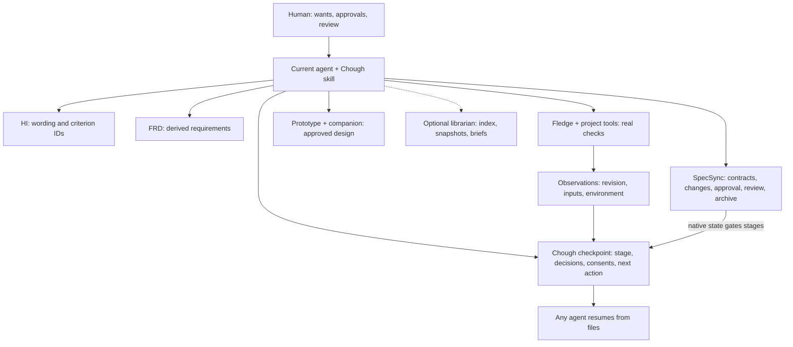
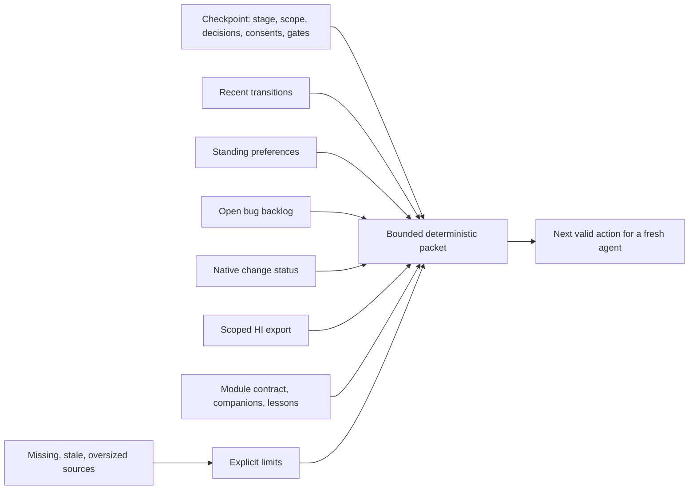

# Architecture

The current agent interprets requests and follows the workflow skill. The Rust helper
does only deterministic work: keep the checkpoint, route stages within native gates,
validate and run test definitions, bind observations, keep local bugs, separate
preferences from consent, snapshot and index the optional library, and install the
skill per host. Each existing tool keeps its own records.

## Records and owners

| Path | Owner and meaning |
|---|---|
| `INTENT.md`, `hi/*.md` | HI: human wording and permanent criterion IDs |
| `docs/FRD.md` | Workflow synthesis linked to HI and native requirements |
| `specs/<module>/` | SpecSync: contract, requirements, tasks, context, testing, optional `.3md` lessons |
| `.specsync/changes/`, `.specsync/archive/` | SpecSync: change packages, approval, verification, review, archive |
| `design/prototype/` with `COMPANION.md` | The canonical prototype and its rationale and mappings |
| `fledge.toml` | Fledge tasks and lanes |
| `.chough/session.json` | Chough: the single writable checkpoint (schema 2) |
| `.chough/session.v1.json` | The original schema 1 bytes kept by `chough migrate` |
| `.chough/transitions.jsonl` | Append-only stage history |
| `.chough/preferences.json` | Standing project preferences, each with its source |
| `.chough/cases/*.cases.toml` | Test definitions (`chough-testing/1`) |
| `.chough/evidence/*.json`, `.chough/artifacts/` | Observations and captured output |
| `.chough/bugs/*.json` | Local bug backlog |
| `.chough/validation/` | Limits and progress of optional repeated runs |
| `library/` (optional) | Snapshots, briefs and a generated index; never a second current source |
| `<host>/skills/chough-workflow/` | Installed skill copies; edits are preserved |

`.chough/` is plain project data. Commit the checkpoint, cases and bugs when the team
shares them; decide for observations and artifacts by collaboration and
confidentiality needs. The helper uploads nothing.

## Checkpoint authority

There is exactly one writable checkpoint. Hand edits are allowed and validated on
every read (`deny_unknown_fields`, bounded size, closed stage names, project-relative
paths). Commands replace it atomically. With several agents, one agent owns the
checkpoint and the others report back; there is no distributed lock. APS was
evaluated as a backend and deferred (D-010). The checkpoint stores decision summaries
and references, never reasoning transcripts, and it never stores native lifecycle
state: it stores the change ID and reads status when a gate matters.

## A focused packet

`chough context` assembles the packet within 16 KiB per section and 128 KiB in
total; `chough next` adds native status, freshness, gates and the next valid action.
Missing or truncated sources stay visible. Context is source material: it may contain
user or repository text, and it never overrides the host's instructions or
authorizes external actions.

## Evidence is scoped, not permanent achievement

A criterion such as LIFE-2 stays durable. An observation says a particular check was
reported as passed, failed or not run, for specific inputs and an environment. The
Git fingerprint covers the revision and every tracked or untracked non-ignored file
except `.chough/` and `target/`; artifacts are hashed separately; case observations
also bind the case's definition digest. Any of those changing makes the observation
stale. This is deliberately conservative: a later commit, even one that only touches
lifecycle metadata, makes earlier observations stale until they are rerun.

The observation kind says what was observed, not how trustworthy it is. Recording
`human-observation` does not authenticate a person, `deployment-observation` does
not contact a deployed product, and `dry-run` is never a delivery.

## Extension boundary

An adapter consumes a native structured result or bounded source, preserves its
status and trust limits, and contributes context or evidence references. It never
allocates a second change identity or turns a degraded or unknown state into success.
See [integrations](integrations.md) for what is qualified, deferred or unavailable.
