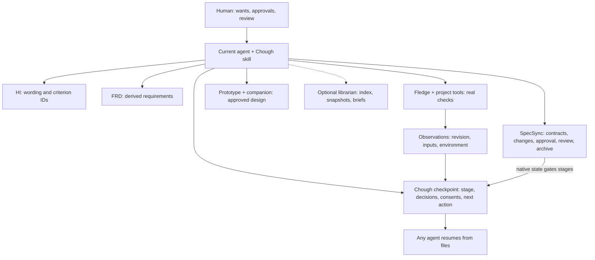
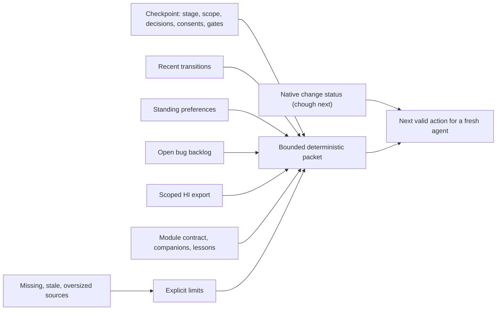

# Architecture

The current agent interprets requests and follows the workflow skill. The Rust helper
does only deterministic work: keep the checkpoint, route stages within native gates,
validate and run test definitions, bind observations, keep local bugs, separate
preferences from consent, snapshot and index the optional library, and install the
skill per host. Each existing tool keeps its own records.

## Records and owners

| Path | Owner and meaning |
|---|---|
| `INTENT.md`, `hi/*.md` | HI: human wording and permanent criterion IDs |
| `docs/FRD.md` | Workflow synthesis linked to HI and native requirements |
| `specs/<module>/` | SpecSync: contract, requirements, tasks, context, testing, optional `.3md` lessons |
| `.specsync/changes/`, `.specsync/archive/` | SpecSync: change packages, approval, verification, review, archive |
| `design/prototype/` with `COMPANION.md` | The canonical prototype and its rationale and mappings |
| `fledge.toml` | Fledge tasks and lanes |
| `.chough/session.json` | Chough: the single writable checkpoint (schema 2) |
| `.chough/session.v1.json` | The original schema 1 bytes kept by `chough migrate` |
| `.chough/transitions.jsonl` | Append-only stage history, including `gate-opened` and `gate-closed` records written when an awaiting-human gate opens or is cleared; `chough timing` derives durations from it and stores none |
| `.chough/preferences.json` | Standing project preferences, each with its source |
| `.chough/cases/*.cases.toml` | Test definitions (`chough-testing/1`) |
| `.chough/evidence/*.json`, `.chough/artifacts/` | Observations and captured output |
| `.chough/pruned.jsonl` | Append-only ledger of observation sets removed by retention |
| `.chough/bugs/*.json` | Local bug backlog |
| `.chough/validation/`, `.chough/validation.stop` | Limits and progress of optional repeated runs, and a pending stop request |
| `library/` (optional) | Snapshots, briefs and a generated index; never a second current source |
| `<host>/skills/chough-workflow/` | Installed skill copies; edits are preserved |

`.chough/` is plain project data, and the helper uploads nothing. By kind:

| Kind | Paths | Normally |
|---|---|---|
| Current working records: what an agent resumes from | `.chough/session.json`, `preferences.json`, `cases/`, `bugs/`, `validation/`; `.specsync/changes/<id>/` | Committed when the team shares the work |
| Historical evidence: append-only history and scoped observations, current only while their inputs match | `.chough/transitions.jsonl`, `evidence/`, `artifacts/`, `pruned.jsonl` | Committed or kept local by collaboration and confidentiality needs; routine runs are prunable (below) |
| Chough's own self-test records: its backlog and run history for building Chough | this repository's root `.chough/` | Committed here; never packaged or installed by `chough init` |
| Examples: rehearsal samples and their case definitions | `examples/<sample>/` | Committed; exercises run in disposable copies whose output is not kept |
| Frozen native archives: SpecSync's record of a closed change, authenticated from Git history | `.specsync/archive/changes/<date>-<id>/` | Committed once; never edited or pruned |
| Canonical skill: the bundle the binary embeds; edit it here | `skills/chough-workflow/` | Committed and packaged |
| Installed host copies written by `init` and `skill update` (byte-identical to the canonical bundle in this repository) | `<host>/skills/chough-workflow/`, here `.agents/` and `.claude/` | Committed in the project that uses them |
| Ignored build output and local caches | `/target`, `.fledge/cache/`, and under `.specsync/`: `hashes.json`, `change.lock`, `config.local.toml`, `backup-3x/` | Never committed |
| CI output | GitHub Actions run logs | Kept by the hosted run; no CI artifact is uploaded |

**Retention.** An observation set is one evidence record plus the artifacts no other
record references. `chough evidence prune` previews by default and changes nothing:
it lists eligible sets with case, environment, age, outcome and bytes, protected sets
with their reason, and warns above 50 MiB. A set is protected when the checkpoint,
any bug, an active native change or the most recent archived one lists it; when it
is not a routine automated run; when it is among the newest 3 automated runs or the
newest failure for its case and environment; when it is a validation run's failure
or first or last pass; or when it is younger than 14 days. If native manifests
cannot be read, everything they could protect stays protected. `--apply` needs a run
consent `retention` or the standing preference `retention auto` (default `off`);
with `auto`, `cases run` and `validate run` apply the same rules after recording.
Each removed set appends a line to `.chough/pruned.jsonl`. Only working-tree files are
removed; Git history, native archives and ignore rules are untouched. A referenced
observation is labelled `current`, `historical` (present but stale), `pruned` (absent
and in the ledger) or `unavailable` (absent and not in it); pruned and unavailable
ones never count as current or passed.

**Large artifacts.** Artifacts stay inside the project: absolute, `..` and symlinked
paths are refused, and there is no external artifact location. Keep screenshots,
recordings and other binaries small. A large one may be ignored by Git
(`.gitignore` or `.git/info/exclude`): the observation still keeps its fingerprint
and reads `current-observation` where the file exists, while a clone without the file
reads `stale-artifact`, never passed. Git LFS is not recommended, because SpecSync
`change check` currently refuses tracked LFS files (CorvidLabs/spec-sync#789).

## Checkpoint authority

There is exactly one writable checkpoint. Hand edits are allowed and validated on
every read (`deny_unknown_fields`, bounded size, closed stage names, project-relative
paths). Commands replace it atomically. With several agents, one agent owns the
checkpoint and the others report back; there is no distributed lock. APS was
evaluated as a backend and deferred (D-010). The checkpoint stores decision summaries
and references, never reasoning transcripts, and it never stores native lifecycle
state: it stores the change ID and reads status when a gate matters. Because SpecSync
6.1.1 status does not report an edited approved delta (BUG-0002), the gate into build,
test and accept also reads the native approval ledger
(`.specsync/changes/<id>/approvals.json`) and the change's deltas read-only, within
4 MiB each, and compares SpecSync's own approved-delta digests; it copies nothing into
Chough's records and starts no process.

## Timing is derived, not stored

`chough timing` reports how long stages, tests, bug fixes and human gates took from
the records above; it writes nothing and keeps no timing store. The one record added
for it is a pair of transition kinds: `chough checkpoint` appends `gate-opened` when an
awaiting-human gate opens and `gate-closed` when it is cleared, in the call that
already writes the checkpoint, so waiting time survives `--clear-awaiting-human`. They
record when, never who decided or what, and they start or end no stage segment.
Native times are read from `specsync change status` and, read-only, the gate and
timestamp fields of a change's native record files; validity comes only from status,
and nothing native is copied into Chough's records. Every duration is labelled elapsed
wall-clock time, not effort; same-second segments are `recorded together`; missing or
out-of-order times are `unknown` with a reason, never zero; history ranges are
estimates with their sample count, not targets, and fewer than 3 samples are too few
to estimate. See [the CLI reference](cli.md#timing).

## A focused packet

`chough context` assembles the packet within 16 KiB per section and 128 KiB in
total; `chough next` adds native status, freshness, gates and the next valid action
as a focused view of at most 16 KiB from one native status read, and `chough status`
is the full report.
Missing or truncated sources stay visible. Context is source material: it may contain
user or repository text, and it never overrides the host's instructions or
authorizes external actions.

## Evidence is scoped, not permanent achievement

A criterion such as LIFE-2 stays durable. An observation says a particular check was
reported as passed, failed or not run, for specific inputs and an environment. Each
observation records the Git revision, which is shown and used for regression
ancestry but not compared. Freshness compares a working content identity that covers
every tracked or untracked non-ignored file except `.chough/`, `target/` and SpecSync
lifecycle bookkeeping (a change's state, approval, verification, review,
finalization, accepted-state and lesson-bundle records and the front-matter `state:`
of `change.md`); a change's deltas and other artifacts stay covered wherever the
change directory is. Artifacts are hashed separately; case observations also bind the
case's definition digest. Any of those changing makes the observation stale, while
committing only Chough records, an empty commit or SpecSync bookkeeping does not.
Records without a content identity keep the earlier revision-bound comparison. This
narrow form of reuse is D-018, which supersedes the deferral in D-016; the broader
[proposal](NEXT_CHANGE.md) with ancestry checks and a separate label stays unapproved.

The observation kind says what was observed, not how trustworthy it is. Recording
`human-observation` does not authenticate a person, `deployment-observation` does
not contact a deployed product, and `dry-run` is never a delivery.

## Extension boundary

An adapter consumes a native structured result or bounded source, preserves its
status and trust limits, and contributes context or evidence references. It never
allocates a second change identity or turns a degraded or unknown state into success.
See [integrations](integrations.md) for what is qualified, deferred or unavailable.
