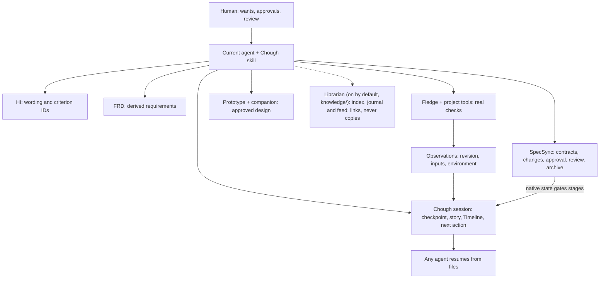
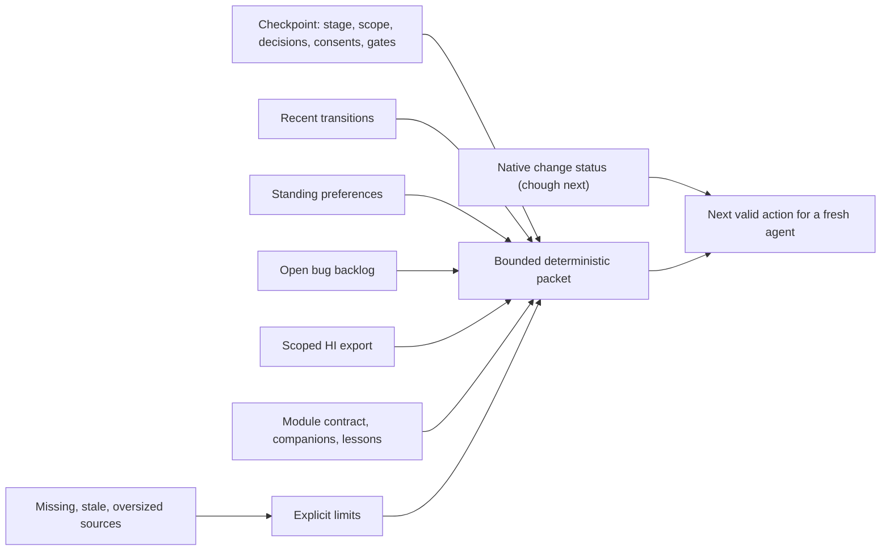

# Architecture

The current agent interprets requests and follows the workflow skill. The Rust helper
does only deterministic work: keep the checkpoint, route stages within native gates,
validate and run test definitions, bind observations, keep local bugs, separate
preferences from consent, index the librarian's knowledge directory and write its
journal (on by default), and install the skill per host. Each existing tool keeps its own records.

## Records and owners

| Path | Owner and meaning |
|---|---|
| `INTENT.md`, `hi/*.md` | HI: human wording and permanent criterion IDs |
| `docs/FRD.md` | Workflow synthesis linked to HI and native requirements |
| `specs/<module>/` | SpecSync: contract, requirements, tasks, context, testing, optional `.3md` lessons |
| `.specsync/changes/`, `.specsync/archive/` | SpecSync: change packages, approval, verification, review, archive |
| `design/prototype/` with `COMPANION.md` | The canonical prototype and its rationale and mappings |
| `fledge.toml` | Fledge tasks and lanes |
| `.chough/README.md` | Chough: the one-screen guide to this tree, written create-only by `init` and `migrate --apply` |
| `.chough/sessions/<id>/session.md` | Chough: one open session. Its front matter is the checkpoint; its body is the story and the append-only Timeline. Only the active session is written |
| `.chough/sessions/<id>/evidence/` | Chough: the session's evidence entries, one Markdown file each (a repeated validation run is one entry), and at most 5 small key screenshots |
| `.chough/sessions/<id>/agent/` | Agent working files, with `inbox/` for create-only subagent reports that the session's owner folds |
| `.chough/archive/sessions/<id>.md` | One story per finished session, kept for good, with a receipt per evidence entry; a folder of the same name beside it holds its screenshots, when it has any |
| `.chough/archive/shelved/<id>/` | A session that could not be read, moved byte for byte by `session shelve` |
| `.chough/archive/migrations/<id>.md` | The receipt of a migration from 0.5.x |
| `.chough/bugs/<id>.md` | The local bug backlog: one Markdown record per bug with an append-only `## Log`; earlier IDs are aliases |
| `.chough/preferences.json` | Standing project preferences, each with its source |
| `.chough/cases/<module>.cases.toml` | Test definitions (`chough-testing/1`) with curated `TC-<module>-<title-slug>` IDs for new cases and exact legacy numeric IDs retained |
| `.chough/local/` | One worktree's machine-local state, ignored by Git: the active-session pointer, the writer lock, gate lists, direct-write baselines, `external-artifacts.toml`, `logs/`, a pending `validation.stop` and an optional `identity.toml` |
| `knowledge/` (librarian, on by default; `library-dir` renames it, `librarian off` opts out) | The generated reading guide `index.md`, the journal in `journal/` with its generated `feed.xml`, and cross-project lessons in `lessons/`. It links and never copies a record or source, and no gate reads it. Earlier `library/` snapshots and `briefs/` are kept as they are |
| `<host>/skills/chough-workflow/` | Installed skill copies; edits are preserved |

Every record Chough writes is one Markdown file with YAML front matter, and the file is
the record's only source of truth (REQ-records-001). The front matter is a strict YAML
subset that Chough reads and writes without a dependency, and it holds the fields
agents parse. The body is for people. Chough owns only the front matter and the
sections it appends to: it keeps any front matter key it does not know, and every body
line a person wrote. Records are bounded: 64 KiB each, 1 MiB for a session or story,
and 4 MiB for a migration receipt. A value Chough would commit is checked for local
paths, user and host names, emails and credentials, and refused as `refused:leak`
unless `--redact` stores a placeholder (REQ-records-006).

`.chough/` is plain project data, and the helper uploads nothing. By kind:

| Kind | Paths | Normally |
|---|---|---|
| Current working records: what an agent resumes from | `.chough/sessions/`, `preferences.json`, `cases/`, `bugs/`; `.specsync/changes/<id>/` | Committed when the team shares the work |
| History: one story per finished session and the migration receipt | `.chough/archive/` | Committed and kept for good; never moved, copied or trimmed |
| Chough's own self-test records: its backlog and run history for building Chough | this repository's root `.chough/` | Committed here; never packaged or installed by `chough init` |
| Examples: rehearsal samples and their case definitions | `examples/<sample>/` | Committed; exercises run in disposable copies whose output is not kept |
| Frozen native archives: SpecSync's record of a closed change, authenticated from Git history | `.specsync/archive/changes/<date>-<id>/` | Committed once; never edited or pruned |
| Canonical skill: the bundle the binary embeds; edit it here | `skills/chough-workflow/` | Committed and packaged |
| Installed host copies written by `init` and `skill update` (byte-identical to the canonical bundle in this repository) | `<host>/skills/chough-workflow/`, here only the shared `.agents/`; an older `.claude/` copy is reported as legacy and removed only by `skill remove-legacy` | Committed in the project that uses them |
| Ignored build output and local state | `/target`, `.fledge/cache/`, `.chough/local/`, and under `.specsync/`: `hashes.json`, `change.lock`, `config.local.toml`, `backup-3x/` | Never committed |
| CI output | GitHub Actions run logs | Kept by the hosted run; no CI artifact is uploaded |

**Names.** A new session, evidence entry, bug, inbox entry, journal post and migration
receipt is named `<YYYY-MM-DD>-<slug>`: the UTC date it was created and a slug of its
key or title, at most 80 bytes in all (REQ-records-003). Nothing is named by a counter.
A same-folder clash at creation gets `-` and six hex digits from 24 random bits, drawn
directly with the existing getrandom 0.4.3 package, and is written by create-new. A
second clash is refused, with nothing written and no second draw. A name never
changes. Every ID a record had before 0.6.0, such as `BUG-0012`, an `OBS-` ID or a
session key, is kept in the record's `aliases` and resolves wherever an ID is taken.
An alias held by two records is refused where it is resolved and reported by
`chough doctor`. Case IDs stay curated definitions, with exact legacy numeric cases and
their digests unchanged. Timestamps stay in their own fields and decide chronology,
never identity.

**Nothing is trimmed.** No command removes a committed record or working file unless
its exact bytes are committed at HEAD (REQ-records-012). Every finished session stays
one story in `.chough/archive/sessions/`. A record that a migration removed without
carrying it reads `removed`, naming the receipt, and never counts as current or
passed.

**Proof files.** A raw log is never committed. A case run's output goes to
`.chough/local/logs/<evidence id>.log`, and its entry keeps the exact command, the
output's SHA-256 and, for a failure, at most 20 key failing lines (REQ-records-005). An
artifact outside the project is fingerprinted in place, its path kept only in
`.chough/local/external-artifacts.toml` under a neutral ID; elsewhere it reads
`external, not checkable here`. A key screenshot (PNG or JPEG, at most 512 KiB, 5 and
2 MiB per session) is committed beside its entry with its metadata removed, and moves
beside the story when the session finishes (REQ-records-013).

## Checkpoint authority

There is exactly one writable checkpoint at a time: the front matter of the active
session's `.chough/sessions/<id>/session.md`, named by `.chough/local/active-session`
or, with no pointer, the only open session that is not finished. Hand edits are
allowed and validated on every read: the strict YAML subset, the keys and their
types, the size bound and closed stage names. A key Chough does not know is kept. Each
command resolves the active session once and saves only to it, by an atomic replace.
Every command that writes a record takes the project's writer lock,
`.chough/local/checkpoint.lock`, so parallel writers in one worktree apply in turn
(DRIVE-11). The lock records its holder's process ID, so a busy refusal can name it.
With several agents, each pull request records its work in its own session, one
agent owns each session, and subagents report with `chough inbox add`; there is no
lock across clones. APS was evaluated as a backend and deferred (D-010). The
checkpoint stores decision summaries and references, never reasoning transcripts, and
it never stores native lifecycle state: it stores the change ID and reads status when
a gate matters.

There is no checkpoint merge. Each session is its own folder,
`.chough/sessions/<date>-<slug>/`, so branches that work on different sessions merge
with no conflict, and the Timeline in each `session.md` is append-only, so a branch
that only appended entries merges cleanly with its own base.

## Timing is derived, not stored

`chough timing` reports how long stages, tests, bug fixes and human gates took from
the records above; it writes nothing and keeps no timing store. It reads every open
session's Timeline and every archived story's, and case runs from evidence entries and
from the receipts of stories and bugs. The one record added for it is a pair of
Timeline entry kinds: `chough checkpoint` appends `gate-opened` when an awaiting-human
gate opens and `gate-closed` when it is closed, in the same save as the checkpoint
change, so waiting time survives `--clear-awaiting-human`. They record when, and they
start or end no stage segment. A gate closed with `--close-gate` also carries the
relay: who is said to have decided, their words, where, and the recording agent
(REQ-cli-050), plus the SpecSync step it ran and the actor it ran as when the gate
drove one (REQ-history-010). Timing does not report the relay, and Chough does not
authenticate it.
Native times are read from `specsync change status` and, read-only, the gate and
timestamp fields of a change's native record files; validity comes only from status,
and nothing native is copied into Chough's records. Every duration is labelled elapsed
wall-clock time, not effort; same-second segments are `recorded together`; missing or
out-of-order times are `unknown` with a reason, never zero; history ranges are
estimates with their sample count, not targets, and fewer than 3 samples are too few
to estimate. See [the CLI reference](cli.md#timing).

## A focused packet

`chough context` assembles the packet within 16 KiB per section and 128 KiB in
total; `chough next` adds native status, freshness, gates and the next valid action
as a focused view of at most 16 KiB from one native status read, and `chough status`
is the full report.
Missing or truncated sources stay visible. These budgets are for display only: a cut
names itself and sends the reader to the complete source, and gates and validation read
native sources whole (REQ-cli-042, LIFE-15). Context is source material: it may contain
user or repository text, and it never overrides the host's instructions or
authorizes external actions.

## Evidence is scoped, not permanent achievement

A criterion such as LIFE-2 stays durable. An observation says a particular check was
reported as passed, failed or not run, for specific inputs and an environment. Each
observation records the Git revision, which is shown and used for regression
ancestry but not compared. Freshness compares a working content identity that covers
every tracked or untracked non-ignored file except `.chough/`, `target/`, the generated
knowledge directory (the configured `library-dir`, `knowledge/` by default) and SpecSync
lifecycle bookkeeping (a change's state, approval, verification, review,
finalization, accepted-state and lesson-bundle records and the front-matter `state:`
of `change.md`); a change's deltas and other artifacts stay covered wherever the
change directory is. Artifacts are hashed separately; case observations also bind the
case's definition digest. Any of those changing makes the observation stale, while
committing only Chough records, an empty commit or SpecSync bookkeeping does not.
A receipt migrated from an observation with no content identity keeps the earlier
revision-bound comparison. This
narrow form of reuse is D-018, which supersedes the deferral in D-016; the broader
proposal with ancestry checks and a separate label stays unapproved, and Git history
holds it.

The observation kind says what was observed, not how trustworthy it is. Recording
`human-observation` does not authenticate a person, `deployment-observation` does
not contact a deployed product, and `dry-run` is never a delivery.

## Extension boundary

An adapter consumes a native structured result or bounded source, preserves its
status and trust limits, and contributes context or evidence references. It never
allocates a second change identity or turns a degraded or unknown state into success.
See [integrations](integrations.md) for what is qualified, deferred or unavailable.

## Request-local report reads

Report freshness uses one root-bound ephemeral case index. Its first bound-case
lookup runs the existing structural loader, including file bounds, shape and global
uniqueness checks. Later lookups in that request reuse the parsed suite and the same
case-digest representation. Status shares it between its all-observation and
reference-label passes. Existing label owners also keep one index for their own
request. Missing/retired cases and malformed suites retain their explicit outcomes.

The index owns no native result, artifact result, checkpoint or persistent cache.
Every later request starts fresh. Source snapshots, artifact bytes, requested
environment and native gates keep their existing semantics. Opt-in stderr phases
and load/lookup counts expose local work without changing report schemas or records.
Native wait remains independently bounded and reported by the native reader.

## Timelines and finished sessions

Each transition is one entry of its session's `## Timeline`:
`- <time> · <kind> · <from> → <to> · <text> ^t-xxxxxx`, with its structured fields as
indented `- key: value` lines, `by` naming the acting agent when known (REQ-history-002).
The entry and the checkpoint change it goes with are one atomic replace of
`session.md`, so a refused save leaves neither. Chough only appends entries and never
edits, reorders or removes one; `chough correct` appends a correction that links the
entry it corrects (REQ-history-015). `chough doctor` reports a Timeline whose committed
entries were rewritten. An entry is at most 64 KiB and a Timeline at most 4,096
entries. Recent guidance reads the newest 128 entries, and timing reads at most 4,096
entries and 16 MiB of Timelines per request, reporting the rest as partial.

A session closes only itself, at its own move into done or with `chough session close
--reason`. It writes its story, `.chough/archive/sessions/<id>.md`, by create-new: the
front matter with the outcome and a receipt per evidence entry, the story as written,
the Timeline and a closing line. Chough reads the story back, then removes each file
of the session folder whose bytes are committed at HEAD, keeps and reports the rest,
and clears the active pointer. `chough doctor --fix` finishes the removal after the
commit. Starting or switching work never reads, moves or rewrites another session's
folder or story. There is no roll-up and no count or age bound on the archive.
