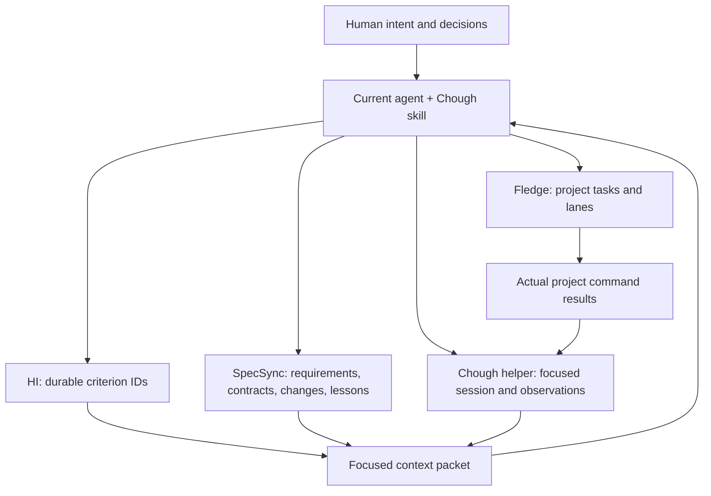
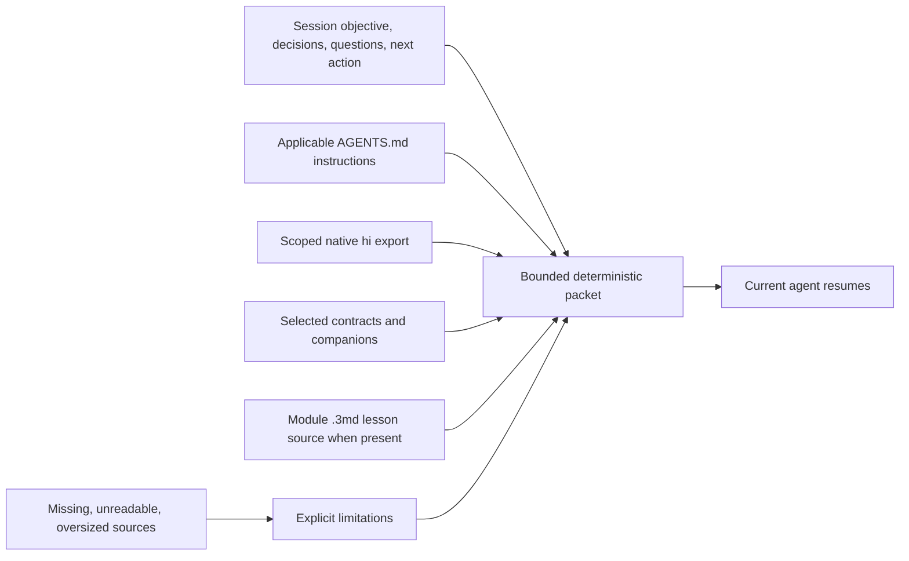

# Architecture

## Current foundation

The current agent interprets the request and uses the workflow skill. The helper
handles small deterministic operations: preserve a session, select context, validate
observations, and expose native status. Each existing tool keeps its own records.

## Local records

| Path | Owner and meaning |
|---|---|
| `INTENT.md`, `hi/*.md` | HI: human wants and permanent criterion IDs. |
| `docs/FRD.md` | Workflow synthesis: sized functional requirements linked to intent. |
| `specs/<module>/` | SpecSync: module contracts, requirements, tasks, context, testing, and optional `.3md` lessons. |
| `.specsync/changes/`, `.specsync/archive/` | Native change, approval, verification, review, and archive records. |
| `fledge.toml` | Fledge: task and lane definitions. |
| `.chough/session.json` | Chough: selected objective, scope, modules, decisions, questions, next action. |
| `.chough/evidence/*.json` | Chough: observations tied to revision, worktree, environment, IDs, contracts, and artifacts. |
| `.agents/skills/chough-workflow/` | Installed project skill; existing user changes are preserved. |

`.chough` is plain project-local data. Choose whether to commit shared sessions and
observations according to the project's collaboration and confidentiality needs;
inspect artifacts and context before sharing them. The helper does not upload them.

## A focused packet

The session selects modules rather than loading every contract or chat transcript.
When native `.3md` lessons are present, Chough carries that source and marks its
interpretation boundary; it does not silently replace it with a parallel lesson store.
Deterministic output makes repeated context assembly useful for session resumption
and review. Missing input remains visible so an agent can retrieve what matters.

Context is source material. It may contain user or repository text; it does not
override the host's instructions or authorize external actions. Applicable ancestor
instructions can live outside the project root; managed records and selected project
paths remain constrained to their validated destinations.

## Evidence is scoped, not permanent achievement

A criterion such as LIFE-2 remains durable. An observation says that a particular
check was reported as passed or failed for specific inputs and an environment.
The Git fingerprint includes the revision and relevant worktree inputs; Chough's
own working records are excluded so writing another observation does not change
the worktree fingerprint. HEAD is also included: committing even metadata changes the
revision and makes earlier observations stale. Reuse across metadata-only commits
remains an [unapproved, deferred proposal](NEXT_CHANGE.md).
Code edits, a new revision, changed artifacts, or a different environment can make
an observation inapplicable. See the actual status output for the reason.

The observation kind states what was observed: structural validation, a product test,
a human observation, or a delivery observation. It is not a trust level. Recording
`human-observation` does not authenticate a person, and recording a delivery note
does not contact the deployed product. An agent must preserve that distinction.

## Agreed coordination design: not implemented yet

The [planned lifecycle](lifecycle.md) adds stage context, approved scope references,
explicit preferences and local work/test/bug findings to mandatory checkpoints.
The optional librarian supplies project history/indexes/briefs and can return to
any calling stage. Core checkpointing must work with the librarian off. Both
coordinate pointers and observations; they must not duplicate SpecSync's lifecycle
ledger or replace canonical HI, prototypes or contracts.

Today `.chough/session.json` has only `schema_version`, `objective`, `intent_scope`,
`modules`, `decisions`, `open_questions`, and `next_action`. It rejects unknown fields.
Do not add planned stage/preference fields to the current schema and expect them
to work. Full scope-preserving cross-agent cold resume and checkpoint migrations
remain implementation/acceptance work.

APS is a storage-adapter candidate for typed project-local FileState, not an
adopted dependency or a Rust rewrite. Qualification must establish migration and
one checkpoint authority, with one writer per key or isolated agent roots/keys.
Keep the current session compatible until an actual migration is implemented.
3md test definitions and monitoring/librarian records likewise need an explicit
profile/ownership design rather than a claim that stock tools interpret them.

## Extension boundary

An adapter should consume a native structured result or bounded source, preserve
its status and trust limits, and contribute useful context or evidence references.
It should not allocate a second change identity or translate a tool's degraded or
unknown state into success. [Integrations](integrations.md) documents the current
seams; only HI export and SpecSync status are helper integrations in this slice.
