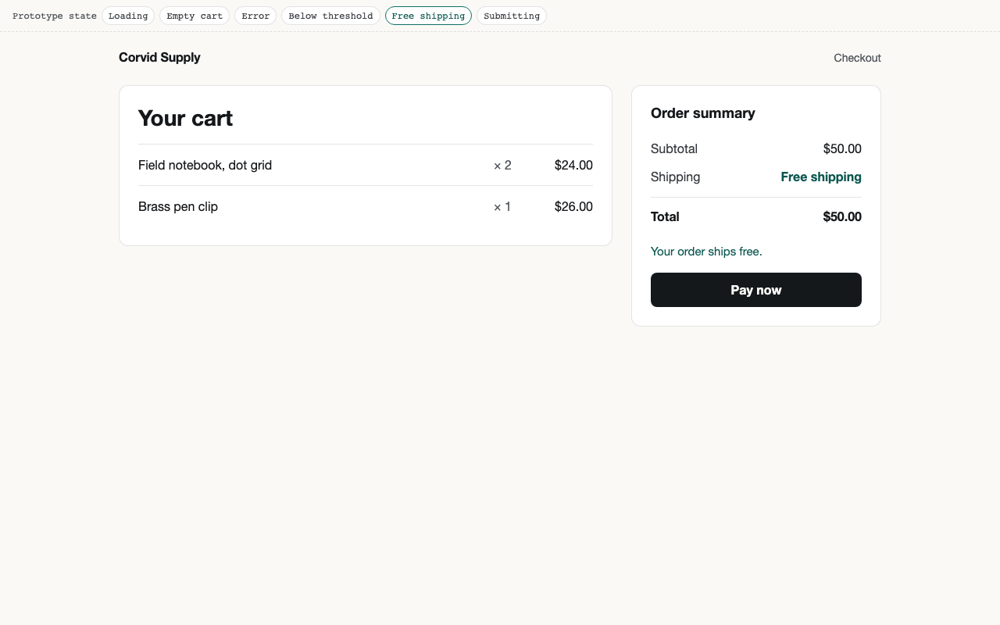
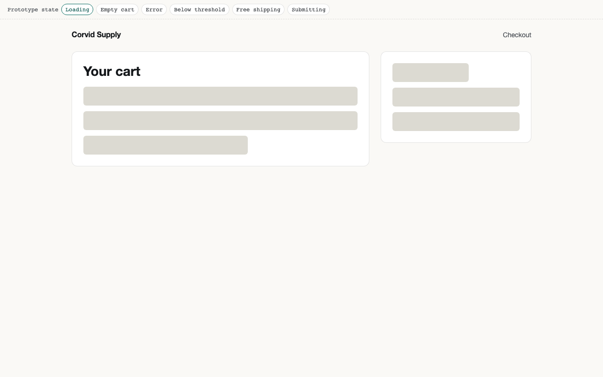
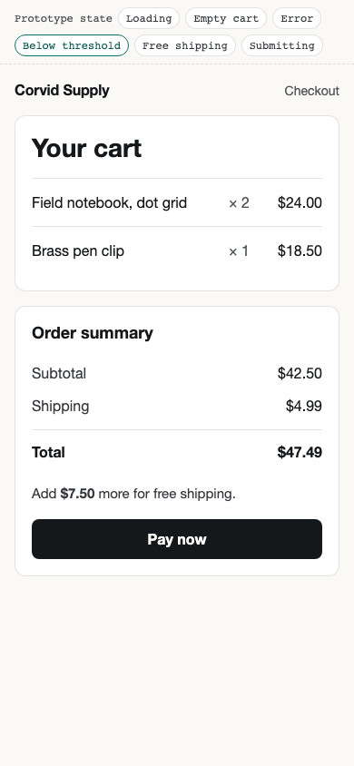
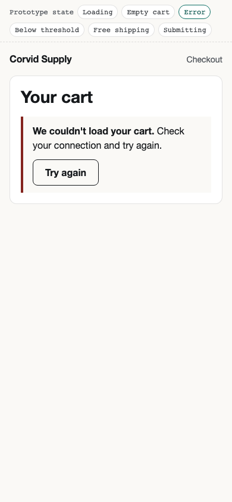

# Exercise: conditional design stage with a rendered review

Requirement links: FLOW-4 (design), FLOW-6 (focused tracks), FLOW-7 (definitions vs
observations). Observed 2026-10-31 on macOS arm64 with chough built from branch
`feat/resumable-stage-workflow`, Bun 1.4, Playwright 1.64.1, Chromium headless shell
1248 and axe-core 4.11.4.

## What it covers

- A nonvisual change skips design with a recorded reason: the shipping exercise
  (`examples/feature-bug-loop.sh`) logs `design -> plan (skip)` with
  "Fee calculation only; no visuals or interactions change".
- A visual change uses one canonical local HTML and CSS prototype,
  `examples/checkout-ui/design/prototype/`, built on CorvidLabs design tokens pinned at
  design-system commit `c698ed4`, with a companion that maps states to HI criteria,
  requirements and cases.
- Rendered review combines deterministic assertions with an agent's visual verdicts,
  and the human design approval stays pending.

## Repeat it

```sh
PLAYWRIGHT_MODULE=/path/to/node_modules/playwright/index.mjs \
AXE_SCRIPT=/path/to/node_modules/axe-core/axe.min.js \
CHOUGH="$PWD/target/debug/chough" sh examples/visual-design.sh
```

The script copies the sample into an empty directory, initializes Git and Chough
for the claude host, enters the design stage, records the pending design approval,
selects cases for a visual change, and runs `TC-checkout-ui-0001` through `chough
cases run`. It then stops, because the visual verdict needs someone to look.

## Observed

Selection for `--requirement REQ-checkout-ui-001 --track design-qa` chose
TC-checkout-ui-0001 (automated) and TC-checkout-ui-0002 (agent-assisted) and omitted
TC-checkout-ui-0003 with "copy-localization track not requested as relevant to this
change".

`TC-checkout-ui-0001` passed: 47 assertions over six states (loading, empty, error,
below threshold, free shipping, submitting) at 1280x800 and 390x844. They cover
fee and hint wording, panel visibility, horizontal overflow, the disabled Pay button,
and axe-core WCAG 2 A/AA with no violations. Observation
`tc-checkout-ui-0001-1793472480` at sample revision `a5556e2`.

`TC-checkout-ui-0002` passed with verdicts 1 to 4 from Claude (Opus 5.5), recorded
as `agent-assisted` (observation `tc-checkout-ui-0002-1793472517`). The
[reviewer note](visual-review/reviewer-note.md) lists exactly which renders were
inspected and what was not.

The review found one defect that the source checks missed: on desktop, the loading
state left the summary column empty, so the layout would jump when it loaded. The
same canonical prototype was iterated (iteration 2 adds a summary skeleton) and
re-rendered; the companion records both iterations.

| Free shipping, desktop | Loading after iteration 2, desktop |
|---|---|
|  |  |

| Below threshold, mobile | Error, mobile |
|---|---|
|  |  |

`chough next` afterwards: stage `design`, next valid action "Waiting for a human
decision: Design approval of design/prototype (rendered prototype and companion
together). Do not record it on their behalf".

## Limits

- Agent review is not human review, and nothing here is design approval.
- Brand fonts were not loaded in the offline render; system fallbacks show.
- Focus order, screen-reader output and dark mode were not exercised; the human copy
  review TC-checkout-ui-0003 was not performed and has no observation.
- The observations are bound to the disposable sample repository; they are copied
  here as a record, not as evidence about Chough's own revision.
