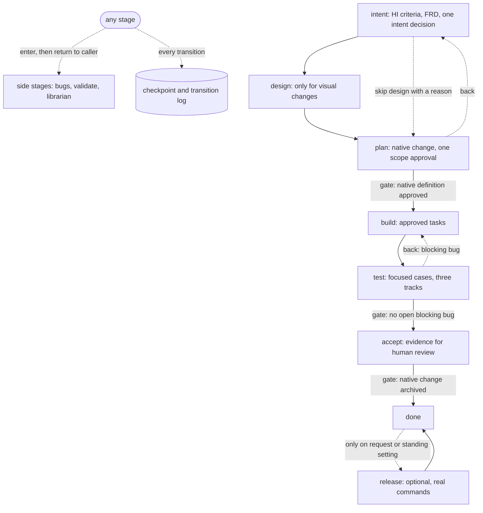
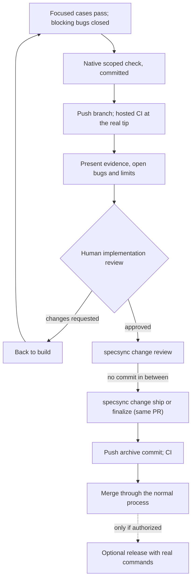

# The development loop

Chough's skill guides this loop; HI, SpecSync, Fledge, the repository host and the
real environment keep their responsibilities. Current tool help and `specsync change
status` take precedence over any cached sequence.

## Stages

Every stage shares one contract (purpose, inputs, outputs and owners, roles,
completion evidence, approval policy, questions, checkpoint content and transitions),
documented in [references/stages.md](../skills/chough-workflow/references/stages.md).
Any stage can iterate, go back, reset, pause, resume or be skipped with a reason.
History is append-only; going back lists what to refresh and, after native
approval, points to native reapproval for changes to intent, contract, acceptance
criteria or scope.

Human decisions sit at natural points, not at every step: the intent as a whole,
the rendered design with its companion, one native scope approval, and the
implementation review at acceptance. Agents synthesize review findings before
asking, and keep doing independent work while a gate is pending.

## Testing in three tracks

Functional checks always run for the affected criteria and impacted behavior.
Copy and localization checks run when visible text or locale behavior changes;
design QA runs when visuals or interactions change. `chough cases select` returns
the focused set and names every omission. Definitions and observations are separate
records, and a failing case stays failed even when others pass. See
[the testing reference](../skills/chough-workflow/references/testing.md).

## Acceptance and native closeout

The order before the review is: when the delta adds or modifies requirements, run
`specsync change check <id>` first to materialize them; `chough cases run`; record the
gate with `chough checkpoint --awaiting-human`; commit the source together with
`.chough/`; `specsync change check <id> --commit`; push and observe hosted CI; present
the work. After the human decision come `specsync change review`, then `ship` or
`finalize`, and only then clearing the gate and `chough stage advance`. Between the
check and finalize, nothing writes to `.chough/` and nothing is committed.

This order is an interim measure. Chough's observations stay current across
commits of its own records and SpecSync's bookkeeping, because freshness compares
content and leaves those records out. SpecSync's verification digest, however, covers
every non-ignored file, including `.chough/`, and has no exclusion setting; until
SpecSync offers an opt-in verification exclusion (the proposed upstream
`verification_ignored_paths`), any Chough write in that window forces another
`change check`.

`specsync change check <id> --commit` materializes the approved delta and records
targeted structural verification; it does not run product tests and refuses while
tasks are unchecked. The human implementation review happens after verification and
before archive; the native `review` record follows a real decision only. Then `ship`
or `finalize` archives on the same pull request without an intervening commit.
`chough stage advance` leaves accept only when native state is `archived`.

## Release, monitoring and learning

Finishing never enters release. Release, publication, installation, deployment and
live health are separate observations, entered only on request or under a standing
project setting. Optional repeated validation and monitoring follow run consent or
standing preferences and keep findings locally. Lessons can be recorded at any stage
in the native module source (`<module>.3md` lesson plane or `context.md`) with their
source, scope and future use.

## Adoption in this repository

The bootstrap used native structural checks with SDD disabled and claimed no
approval. Chough then adopted the workflow-v2 lifecycle (commit c582a10), and the
first fully native change is `evolve-chough-into-a-resumable-stage-workflow`, approved
by the human before implementation. Its implementation review and archive are human
and native steps that the agent does not perform.
