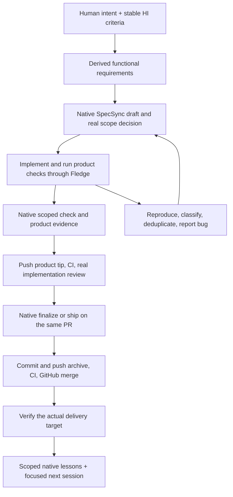

# The native development loop

Chough's skill guides this loop. HI, SpecSync, Fledge, the repository host, and the
actual product environment retain their native responsibilities. Consult current
tool help and `specsync change status` rather than assuming a cached sequence is valid.




## Begin with the want

Capture what the human wants using `hi`, preserving IDs. Clarify contradictions and
meaningful product choices. Proposed additions remain proposals. Export the affected
scope with `hi export`; synthesize requirements and acceptance criteria from it.
FRD synthesis is Chough's workflow responsibility, not a feature of `hi`.

Read affected contracts and companions before selecting an implementation. Keep
requirements appropriately sized: enough to specify observable behavior and failure
cases without turning each implementation detail into a permanent product promise.

## Use SpecSync's own change package

For a later scoped change, start from the installed command help:

```sh
specsync change new "Preserve checkout retry intent" \
  --spec checkout --path src/checkout.rs --json
specsync change status preserve-checkout-retry-intent --json
```

Complete the native interview and selected artifacts. Obtain a real scope decision
before recording native approval. An actor string is a label, not evidence of
identity or human authorization.

After implementing and running relevant product checks:

```sh
specsync change check preserve-checkout-retry-intent --commit
specsync change status preserve-checkout-retry-intent --json
```

The scoped check materializes approved deltas and validates structure. It does not
execute arbitrary product tests. Preserve the actual command outputs and test
artifacts separately, linked to HI and requirement IDs.

Push the product tip, satisfy the repository's CI and trust policy, and complete
real implementation review. Record the native review only when that decision exists.
Then use the eligible `change ship` or `change finalize` action reported by native
status. Do not commit between recording review and finalizing; the native review
binds a workspace digest. Finalize changes sequentially, not as a batch of reviews.

Commit and push the archive tip on the same PR, wait for its required CI, and merge
only after every change on that PR is archived. GitHub performs the merge. When
evidence becomes stale or a phase fails, use the exact native status/recovery output;
do not guess that another `check` is always the correct next step.

These boundaries follow the [SpecSync workflow](https://github.com/CorvidLabs/spec-sync/blob/main/AGENTS.md).

## Delivery and compounding

Verify the actual target promised to the human. A local test, green CI run, merged
PR, package release, deployment, and a successful interaction with the delivered
product are separate events. Record only the event observed and its environment.

Preserve a lesson when it will change a future decision. Give it a source, scope,
concrete future use, and revision or retirement rationale. Use the module's native
`.3md` lesson source where it exists, otherwise the native context convention.
Do not accumulate a second global history of every action.

## Bootstrap boundary

The initial Chough build was explicitly authorized. It uses HI, Fledge, and native
SpecSync structural checks with upstream's default disabled SDD policy. It does not
contain invented human approval/review records or claim an archived full lifecycle.
The first real scoped feature is the opportunity to exercise that lifecycle with
the human's actual decisions and final delivery evidence.
