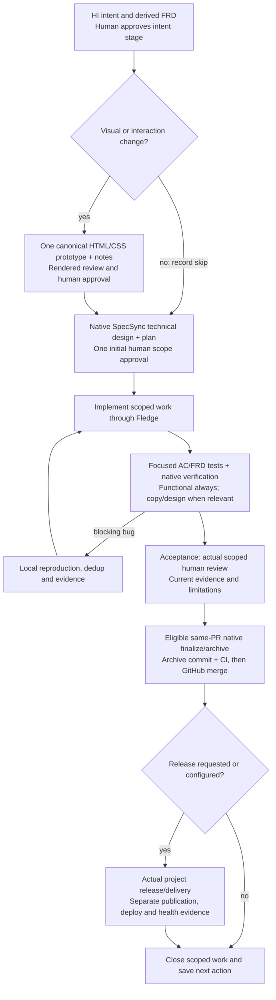

# Lifecycle: current foundation and agreed design

The current implementation provides a starter skill plus `init`, `context`,
`status`, `next`, and `evidence add`. The agent follows guidance and invokes native
tools. It does not implement the stage coordination, test profile, preference
store, monitoring or librarian described below. See the [CLI reference](cli.md)
for implemented behavior and the [roadmap](ROADMAP.md) for planned work.

## Agreed workflow design

This is product direction, not an approved native change definition or evidence
that every stage has been implemented. Current-agent-first works through a capable
host; relevant review roles may be subagents or sequential role passes. No model
provider API or new agent runtime is required.




| Stage | Intended output and human decision |
|---|---|
| Human intent → FRD | Preserve human wording and stable HI/AC IDs; derive appropriately sized requirements, scope/exclusions, consequential assumptions and questions. Product/user advocate, QA/QE, design, accessibility, engineering and architecture roles review concrete criteria/FRD sections. Synthesize findings; human approves the intent stage as a whole. |
| Conditional visual design | For visual/interaction changes, evolve one canonical local HTML/CSS prototype with lightweight interactions as needed, relevant states/viewports, historical versions and a companion Markdown file mapping decisions/questions to HI/AC/FRD. Review source, interactions and actual rendered visuals; human approves prototype and notes. Nonvisual work skips with a reason. Figma is not required. |
| Technical preparation | SpecSync drives adaptive artifacts, constraints, architecture, affected contracts, dependencies, planning, estimates, tasks and verification. Human gives one coherent initial scope approval covering technical design and planning before implementation. |
| Implementation | Execute scoped tasks through Fledge/native frameworks, coordinate file ownership, and keep contracts/tests/docs synchronized. Routine work continues inside approved scope; consequential scope changes return to the applicable decision loop. |
| Focused testing and local bugs | Verify affected HI/AC/FRD plus relevant regressions; persist failures/reproductions locally, deduplicate and maintain a live backlog. Acceptance-blocking bugs loop through implementation/retest; out-of-scope findings queue without expanding approved work. |
| Acceptance / native closeout | Present current evidence and limitations for the real scoped human implementation review required by SpecSync. Once eligible, native finalization/archive is routine closeout on the same PR, followed by archive commit/CI and GitHub merge. Archival adds no separate product approval ceremony. |
| Optional release | Enter only by user request or explicit project setting. Observe actual publication, installation, deployment and health separately. Archival/merge is not release authorization. |

Conventional reversible choices proceed without a question for every item.
Consequential decisions go to the human in a small synthesized batch. Rough 95%
alignment is a judgment aid, not a mandatory numerical per-item gate. A native
actor string, agent review, signature or green command cannot manufacture a human
decision. Changing approved intent/contract/acceptance criteria/affected scope
follows native reapproval; routine tests/evidence do not add scope ceremonies.

## Iteration, optional side stages, and checkpoints

Every stage may iterate, go back, reset, pause/resume or skip when inapplicable.
Preserve history, record the reason, and refresh affected evidence through its
native owner. A stage label cannot override native lifecycle eligibility. Design
that changes intent returns to intent; visual polish stays in the design loop.

These side-stage and checkpoint behaviors are **planned**, not helper features:

- **Optional ongoing validation/monitoring:** ordinary required checks run within
  approved work. Optional extended/background checks follow an established project
  preference or a short meaningful question. Run-specific consent does not become
  an “always for this project” setting. Honor override/pause/stop and persist every
  finding locally with evidence. Retry/watch is not soak testing or live health.
  Whether a monitor may initiate a new investigation/proposal remains configurable
  and open; default to local capture, not autonomous remediation.
- **Optional project-local librarian:** callable from any stage, including build,
  testing, monitoring and release, and returns to its caller. Keep source-linked
  originals/history/snapshots, a current index and focused briefs. Preserve living
  HI, prototype, contracts/native archives and visible open bugs as their own
  canonical sources. It is not a shared cross-project vault by default.
- **Mandatory checkpointing:** independent of the librarian. Save objective/stage,
  scope/approval references, files/IDs, decisions/questions/preferences, work/test
  observations, local bugs, blockers and the next action at meaningful checkpoints
  and before handoff/context clearing. A small router loads details progressively.
  A fresh agent without the original conversation must check repository/native
  state and evidence freshness and retain the same scope/preferences/gates. A real
  cross-agent cold-start exercise is an acceptance target, not a bootstrap claim.

## Focused test design and evidence

Functional/basic checks are always required in proportion to the affected change.
Language/copy/localization checks apply when relevant. Design QA applies to visual
or interaction work and compares implementation to the canonical prototype across
relevant states, viewports and accessibility behavior. Do not retest every unrelated
product criterion by default or use AI judgment as the only available oracle.

Test definitions and execution observations stay separate. Planned definitions
need stable case identity independent of plane order, HI/AC/FRD links, setup,
inputs/steps, explicit expected outcomes, method, target environment and artifacts.
Multiple cases may cover one AC; one passing command is not blanket acceptance.
3md is a preferred candidate for a small versioned profile, not an implemented or
locked format. Fledge/Magpie invoke actual project assertions; Magpie's generic
mode judges command exits and does not interpret arbitrary AC prose.

Manual, copy and rendered design judgments retain their method and honest
pending/observed status. A text-only host performs source checks and hands rendered
judgment to a capable agent or human. Bug reporting stays local first; external
publication requires an explicit request or established authorization. New bugs or
enhancements after closure normally become new native changes; repair stale native
evidence through its actual status/recovery path.

## Native SpecSync ordering

The starter skill already describes the native workflow. Use installed help and
`specsync change status` / `ship-status` as authority, not a second Chough ledger.
A typical full cycle is:

```text
native draft/interview + selected artifacts/deltas
→ genuine initial scope approval
→ implementation + relevant product checks
→ native scoped check --commit
→ push product tip + required CI + genuine scoped human review at acceptance
→ eligible ship/finalize on the same PR
→ commit/push archive + required CI
→ GitHub merge
```

A scoped structural check materializes approved deltas and validates structure;
it does not execute arbitrary product tests. Do not commit between native review
and finalize when that would stale the workspace-bound review. Finalize sequentially
when changes share evidence; never merge with active changes that require archival.
Use exact state-specific recovery rather than assuming another check is sufficient.

These are [SpecSync's native responsibilities](https://github.com/CorvidLabs/spec-sync/blob/main/site/src/content/docs/workflow.md).
Actual delivery and lessons retain separate observations: a local pass, hosted CI,
review, merge, package publication, deployment and live product behavior are distinct.
Lessons can arise throughout work and need source, scope, concrete future use and
revision/retirement rationale in native context or the existing module `.3md`.

## This repository's present boundary

The bootstrap used HI, Fledge and strict native structural checks with SDD's
optional policy disabled. No full human-approved/reviewed/archived lifecycle is
claimed. The agreed implementation evolution must deliberately adopt and exercise
that native cycle with genuine decisions. This documentation correction does not
change policy, create native approvals or implement the planned stages.
